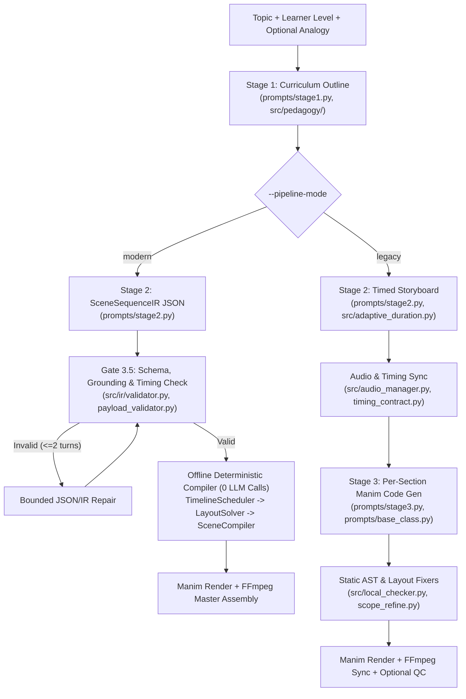

# CineLearn

**Neuro-Symbolic Educational Video Generation via Declarative Scene IR, Deterministic Spatial Layout, and Algorithmic Grounding**

CineLearn is an educational video generation framework built upon [Code2Video](https://github.com/showlab/Code2Video) that compiles technical and STEM topics into executable [Manim Community](https://www.manim.community/) animations with synchronized narration and captions. Alongside the direct LLM-to-Manim pipeline (`legacy`), CineLearn introduces a **Modern Scene IR Pipeline** (`modern`) that decouples LLM pedagogical planning from deterministic timeline scheduling, 2D box-model layout solving, and zero-LLM Manim code compilation.

---

## Table of Contents

- [Motivation](#motivation)
- [Key Features & Contributions](#key-features--contributions)
- [System Architecture](#system-architecture)
- [Pipeline Workflows](#pipeline-workflows)
- [Domain Visual Components & Verifiers](#domain-visual-components--verifiers)
- [Technologies Used](#technologies-used)
- [Repository Structure](#repository-structure)
- [Installation & Environment Setup](#installation--environment-setup)
- [Configuration](#configuration)
- [Running CineLearn](#running-cinelearn)
- [Testing & Evaluation](#testing--evaluation)
- [Evaluation Methodology & Observed Results](#evaluation-methodology--observed-results)
- [Known Limitations & Future Work](#known-limitations--future-work)
- [Acknowledgements & License](#acknowledgements--license)

---

## Motivation

Pixel-based text-to-video models struggle with STEM education because formulas morph, diagrams drift out of alignment, and step-by-step algorithm traces cannot be verified deterministically. Generating Manim Python code directly with an LLM enables vector rendering, yet exhibits three recurring failure modes observed in our evaluations:

1. **Spatial Collisions & Boundary Overflows:** Unconstrained `.shift()` and `.next_to()` calls frequently stack labels, process cards, or pointers on top of one another.
2. **Algorithmic & Pedagogical Drift:** LLMs can omit boundary input values (e.g., array elements or processes) or narrate plausible-sounding but mathematically incorrect intermediate steps.
3. **Fragile Framework Coupling:** Direct code generation relies heavily on runtime base-class injection (`TeachingScene`) and multi-turn error repair loops.

CineLearn addresses these issues by replacing unconstrained Stage 3 code synthesis with a **typed Scene Intermediate Representation (`SceneSequenceIR`)**, **Gate 3.5 schema/semantic/timing verification**, and an **offline deterministic compiler**.

---

## Key Features & Contributions

- **Dual-Pipeline Architecture (`--pipeline-mode modern | legacy`):** Supports both the deterministic Scene IR compilation pipeline and the baseline direct-code pipeline under a unified orchestrator (`src/agent.py`).
- **Declarative Scene IR & Gate 3.5 Verification (`src/ir/`):** Pydantic-validated `SceneSequenceIR` schemas enforce typed entities, viewports, narration anchors, action sequences, component-operation allowlists, and semantic duration budgets prior to compilation.
- **Deterministic Offline Compilation (`src/compiler/`):**
  - `TimelineScheduler` computes explicit start/end timestamps against section duration budgets and fails closed on timing overruns.
  - `HierarchicalBoxModelLayoutSolver` solves non-overlapping 2D positions within safe-frame margins and viewport docks.
  - `DeterministicSceneCompiler` emits self-contained Manim Python scripts with **0 LLM calls** in Stage 3.
- **Multi-Domain Visual Component Library (`src/domains/`):** Reusable `VisualComponent` subclasses for Computer Science, Mathematics, and Chemistry registered via `VisualRegistry`.
- **Algorithmic Grounding & Pedagogical Controls (`src/grounding/`, `src/pedagogy/`):** Topic profiling (`beginner` / `intermediate` / `advanced`), optional analogy suitability routing, deterministic simulators/verifiers (Dijkstra, FCFS, Dynamic Programming, numerical AST evaluation), and storyboard fidelity checks.
- **Model-Agnostic LLM Router (`src/llm/`):** Per-stage provider and model routing across Ollama (local open-weight models), Google Gemini, OpenAI-compatible APIs, and an offline `MockProvider` for testing.
- **Synchronized Audio & Post-Render QC (`src/audio_manager.py`, `src/qc/`):** Edge-TTS / custom audio alignment, concise caption extraction, SRT/VTT subtitle generation, and keyframe/raster quality-control inspection.

---

## System Architecture



---

## Pipeline Workflows

| Stage | Legacy Pipeline (`--pipeline-mode legacy`) | Modern Pipeline (`--pipeline-mode modern`) |
|---|---|---|
| **1. Outline** | LLM generates structured `TeachingOutline` (`prompts/stage1.py`), verified by worked-example gates | Same Stage 1 outline generation + bounded JSON outline repair (`get_prompt1_outline_repair`) |
| **2. Design / IR** | LLM generates natural-language storyboard (`get_prompt2_storyboard`) + fidelity & duration checks | LLM generates typed `SceneSequenceIR` JSON (`get_prompt2_scene_ir`) |
| **3. Verification** | Storyboard fidelity check + math validation + audio handoff validation | **Gate 3.5:** Pydantic schema check + `SceneIRPayloadValidator` (operation allowlists, parameter contracts, duration budget) with up to 2 bounded LLM repair turns |
| **4. Code Synthesis** | $K$ per-section LLM calls (`prompts/stage3.py`) + `TeachingScene` base-class injection + `ScopeRefine` repair | **0 LLM calls:** `TimelineScheduler` -> `HierarchicalBoxModelLayoutSolver` -> `DeterministicSceneCompiler` |
| **5. Render & Assembly** | Manim section renders, `edge-tts` / FFmpeg audio-video muxing, subtitles, optional VLM feedback / QC | Manim compilation of generated scene scripts and FFmpeg master video assembly (`section_manifest.json`) |

---

## Domain Visual Components & Verifiers

### Registered Visual Components (`src/domains/`)

| Domain | Module | Components |
|---|---|---|
| **Computer Science** | [`src/domains/cs/graph.py`](src/domains/cs/graph.py) | `GraphVisual` |
| **Computer Science** | [`src/domains/cs/dp_table.py`](src/domains/cs/dp_table.py) | `DPTableMatrix` |
| **Computer Science** | [`src/domains/cs/os_scheduling.py`](src/domains/cs/os_scheduling.py) | `ProcessCardVisual`, `ReadyQueueVisual`, `CPUExecutionVisual`, `GanttChartVisual`, `MetricTableVisual` |
| **Mathematics** | [`src/domains/math/function_curve.py`](src/domains/math/function_curve.py) | `FunctionCurve` |
| **Mathematics** | [`src/domains/math/number_line.py`](src/domains/math/number_line.py) | `NumberLineVisual` |
| **Chemistry** | [`src/domains/chemistry/molecule.py`](src/domains/chemistry/molecule.py) | `MoleculeVisual` |
| **Chemistry** | [`src/domains/chemistry/reaction_energy.py`](src/domains/chemistry/reaction_energy.py) | `ReactionEnergyDiagram` |

### Grounding & Verification Modules (`src/grounding/`, `src/`)

- **Numerical & Formula Evaluation:** [`src/numerical_evaluator.py`](src/numerical_evaluator.py) (`SafeASTEvaluator`, `TrustedFormulaRegistry`), [`src/math_validator.py`](src/math_validator.py)
- **Worked Example & Storyboard Fidelity:** [`src/worked_example_verifier.py`](src/worked_example_verifier.py), [`src/storyboard_fidelity_checker.py`](src/storyboard_fidelity_checker.py)
- **Trace Grounding & Domain Simulators:** [`src/grounding/trace_engine.py`](src/grounding/trace_engine.py), [`src/grounding/verifiers/dp_verifier.py`](src/grounding/verifiers/dp_verifier.py), [`src/grounding/verifiers/graph/dijkstra_verifier.py`](src/grounding/verifiers/graph/dijkstra_verifier.py) (re-exported via [`src/dijkstra_verifier.py`](src/dijkstra_verifier.py)), [`src/grounding/verifiers/os/fcfs_verifier.py`](src/grounding/verifiers/os/fcfs_verifier.py) (re-exported via [`src/fcfs_verifier.py`](src/fcfs_verifier.py))
- **Post-Render Quality Control:** [`src/qc/keyframe_sampler.py`](src/qc/keyframe_sampler.py), [`src/qc/raster_analyzer.py`](src/qc/raster_analyzer.py), [`src/qc/spatial_projector.py`](src/qc/spatial_projector.py), [`src/qc/controller.py`](src/qc/controller.py)

---

## Technologies Used

- **Language & Validation:** Python 3.10+, Pydantic v2 (`pydantic==2.11.7`)
- **Animation & Rendering:** Manim Community (`manim==0.19.0`), ManimPango, PyCairo, LaTeX (`pdflatex` / `dvisvgm`), FFmpeg / `ffprobe`
- **Audio & Subtitles:** `pydub==0.25.1`, `srt==3.5.3`, `edge-tts==7.3.1`
- **Scientific & AST Analysis:** SymPy, NumPy, SciPy, NetworkX, OpenCV (`opencv-python`), Pillow
- **LLM Backends:** Ollama REST API (`requests`), Google GenAI (`google-genai`), OpenAI-compatible SDK (`openai`)
- **Testing & Acceleration:** `pytest`, optional `orjson`

---

## Repository Structure

```text
CineLearn/
├── src/
│   ├── agent.py                     # Main orchestrator (legacy + modern pipelines)
│   ├── ir/                          # SceneSequenceIR models, Gate 3.5 validators, adapters
│   ├── compiler/                    # TimelineScheduler, LayoutSolver, SceneCompiler
│   ├── domains/                     # VisualComponent registry & CS/Math/Chem components
│   ├── grounding/                   # Trace engine & algorithmic verifiers
│   ├── pedagogy/                    # Topic profiler, teaching beats, verification policy
│   ├── qc/                          # Post-render keyframe & raster/spatial QC
│   ├── llm/                         # Provider-agnostic LLM config & router
│   ├── audio_manager.py             # Edge-TTS synthesis, timestamps, FFmpeg sync
│   ├── audio_handoff_validator.py   # Storyboard-to-audio handoff checks
│   ├── timing_contract.py           # Beat timing & retiming contracts
│   ├── local_checker.py             # AST spatial & boundary checker/fixer
│   ├── scope_refine.py              # Manim error analysis & repair loop
│   └── requirements.txt             # Core Python dependencies
├── prompts/                         # Stage 1-5 prompt templates & TeachingScene base class
├── tests/                           # Automated unit, contract, layout, compiler & QC tests
├── assets/
│   └── reference/GRID.png           # Coordinate grid reference image
├── .env.example                     # Environment variable template
├── llm_config.example.json          # Example per-stage JSON LLM config
├── llm_config.example.yaml          # Example per-stage YAML LLM config
└── pytest.ini                       # Pytest configuration
```

*(Upstream Code2Video/MMMC benchmark datasets under `json_files/` and third-party icons/video frames are excluded from this repository release pending separate dataset redistribution clearance; `src/agent.py` initializes safely without `json_files/long_video_ref_mapping.json`.)*

---

## Installation & Environment Setup

### 1. System Prerequisites

- **Python 3.10+**
- **FFmpeg** (`ffmpeg` and `ffprobe` on `PATH`)
- **LaTeX distribution** (e.g., TeX Live with `pdflatex` and `dvisvgm` for Manim `MathTex` rendering)
- **Manim system libraries** (Cairo, Pango, pkg-config; see the [Manim Community installation guide](https://docs.manim.community/en/stable/installation.html))
- **Optional Local LLM Server:** [Ollama](https://ollama.com/) (existing runtime defaults to `http://127.0.0.1:11435` with configurable `OLLAMA_BASE_URL`; `:11434` URLs are rewritten to `:11435` in `OllamaProvider`)

### 2. Python Dependencies

```bash
python -m venv .venv
source .venv/bin/activate
pip install -r src/requirements.txt
```

To run the automated test suite (`pytest.ini`):

```bash
pip install pytest
```

---

## Configuration

CineLearn reads configuration from environment variables (`.env`) and/or a stage-routing config file (`llm_config.yaml` or `llm_config.json`). **Do not commit real API keys.**

### 1. Environment Variables

Copy the example environment file and configure only the providers you intend to use:

```bash
cp .env.example .env
```

Key variables documented in [`.env.example`](.env.example):
- `LLM_PROVIDER`: `gemini` | `ollama` | `openai`
- `LLM_MODEL`: e.g., `gemini-3.8-flash`, `qwen2.5-coder:32b`, `qwen2.5-coder:7b`, `gpt-4o`
- `GEMINI_API_KEY`: Required only if using Google Gemini
- `OPENAI_API_KEY` / `OPENAI_BASE_URL`: Required only if using OpenAI-compatible endpoints
- `OLLAMA_BASE_URL` / `OLLAMA_MODEL`: Endpoint (current default `http://127.0.0.1:11435`) and model for local Ollama inference
- `ICONFINDER_API_KEY`: Optional legacy placeholder (`src/external_assets.py` resolves asset placeholders to native Manim shapes)

### 2. Per-Stage Model Routing (Optional)

Copy one of the example routing templates ([`llm_config.example.yaml`](llm_config.example.yaml) or [`llm_config.example.json`](llm_config.example.json)) to override providers and models per stage (`outline`, `storyboard`, `code_generation`, `verification`, `repair`, `evaluation`):

```bash
cp llm_config.example.yaml llm_config.yaml
# or
cp llm_config.example.json llm_config.json
```

---

## Running CineLearn

### Single Topic (Python CLI)

Run the **Modern Scene IR Pipeline** (using local Ollama):

```bash
python3 src/agent.py \
  --topic "Binary Search on sorted array [2, 5, 8, 12, 16, 23, 38] searching for target 23" \
  --level intermediate \
  --pipeline-mode modern \
  --provider ollama \
  --model qwen2.5-coder:32b \
  --quality low \
  --no_audio
```

Run the **Legacy Direct Pipeline** with synchronized TTS audio and optional analogy:

```bash
python3 src/agent.py \
  --topic "Dijkstra's Algorithm" \
  --level intermediate \
  --analogy "road navigation" \
  --pipeline-mode legacy \
  --provider ollama \
  --model qwen2.5-coder:32b \
  --quality medium
```

### Key CLI Flags (`src/agent.py`)

| Flag | Default | Description |
|---|---|---|
| `--topic` / `--knowledge_point` | — | Target educational concept |
| `--level` | `intermediate` | `beginner`, `intermediate`, or `advanced` |
| `--analogy` / `--interest` | `""` | Optional analogy or personal interest anchor |
| `--pipeline-mode` / `--pipeline_mode` | `legacy` | `legacy` (Stage 3 LLM code gen) or `modern` (Scene IR deterministic compiler) |
| `--provider` / `--model` | From config / env | Override LLM provider (`gemini`, `ollama`, `openai`, `mock`) and model |
| `--quality` | `medium` | Manim render quality: `low` (480p15), `medium` (720p30), `high` (1080p60) |
| `--audio` / `--no_audio` | `--audio` | Enable or disable Edge-TTS voiceover & synchronization |
| `--burn_subtitles` / `--no_burn_subtitles` | `--burn_subtitles` | Burn concise captions into output video |
| `--parallel` / `--no_parallel` | `--parallel` | Parallel section processing (`--max_workers 4`) |

---

## Testing & Evaluation

### Offline Test Suite

[`pytest.ini`](pytest.ini) configures `testpaths = tests`, `pythonpath = . src`, and skips live LLM/GPU integration tests by default (`-m "not llm_integration"`):

```bash
pytest
```

To run a specific subsystem test file (e.g., Scene IR, layout solver, or compiler):

```bash
pytest tests/test_milestone3a_scene_ir.py tests/test_milestone4a_layout_solver.py tests/test_milestone4b_scene_compiler.py
```

*(Note: tests referencing local optional artifacts in `CASES/` automatically skip when those local artifacts are absent.)*

---

## Evaluation Methodology & Observed Results

CineLearn has been evaluated internally across three frozen Computer Science topics (**Binary Search**, **FCFS CPU Scheduling**, and **Non-Preemptive SJF CPU Scheduling**) using local `qwen2.5-coder:32b` inference (`temperature=0.2`).

### 1. Phase 3 Pilot Study (`N = 8`, Section 1 Scope)

Executed with the internal Phase 3 pilot harness (`evaluation/run_pilot_experiment.py`, omitted from the initial public code release) compiling Section 1 of each lesson (`--no_audio`):

| Metric Dimension | Direct LLM Generation ($N=4$) | Scene IR Pipeline ($N=4$) |
|---|---|---|
| Raw Syntax Validity (`ast.parse`) | 4 / 4 (100%) | 4 / 4 (100%) |
| Raw Standalone Executability | **0 / 4 (0%)** *(requires `replace_base_class`)* | 1 / 4 (25%) |
| Gate 3.5 Passed | N/A | 3 / 4 (75%) |
| Render Completed (Section 1) | 4 / 4 (100%) | 1 / 4 (25%) *(2 halted fail-closed on duration budget overrun)* |
| Collision-Free Layout (`OVL = 0`) | **0 / 4 (0%)** | **1 / 1 (100% of rendered)** |


### 2. Final Comparative Matrix (Internal Evaluation Harness)

A 12-attempt comparative matrix (3 topics × 2 pipelines × 2 attempts) was executed via the internal comparative runner (`evaluation/final_comparison/run_final_comparison.py`, omitted from the initial public code release):
- **Legacy runs:** `LEGACY-BS-01`, `LEGACY-FCFS-02`, and `LEGACY-SJF-01` completed rendering (`48.8s`, `134.8s`, `84.4s`), all with `algorithmic_correctness = False`; `LEGACY-BS-01`, `LEGACY-FCFS-01`, `LEGACY-FCFS-02`, and `LEGACY-SJF-01` exhibited visual overlap defects. Three legacy attempts failed to render all sections (`LEGACY-BS-02`, `LEGACY-FCFS-01`, `LEGACY-SJF-02`).
- **Modern runs:** `MODERN-BS-01` (4/4 sections, `134.0s`), `MODERN-FCFS-02` (3/3 sections, `148.0s`), `MODERN-SJF-01` (4/4 sections, `184.0s`), and `MODERN-SJF-02` (7/7 sections, `87.0s`) produced decoded master MP4s (`algorithmic_correctness = True` on 4 of 5 non-timeout Modern attempts), while `MODERN-FCFS-01` timed out at Stage 1 (900s) and `MODERN-BS-02` rendered 2/4 sections.
- **Recorded Telemetry Caveats:** In the comparative evaluation runner's `sanitize_stage_metrics()`, checking `section_*.py` rather than the Modern compiler's `scene_*.py` filenames caused those 4 rendered Modern runs to be misclassified as `FAILED` / `PARTIALLY_EVALUATED_COMPILATION_FAILED` in the raw summary ledger; additionally, per-checkpoint `layout_*.json` inspection logged intra-group/out-of-screen issues on `MODERN-BS-01`, `MODERN-BS-02`, `MODERN-FCFS-02`, `MODERN-SJF-01`, and `MODERN-SJF-02`.

---

## Known Limitations & Future Work

- **Spoken Tie-Break Phrasing & Table/Gantt Composition:** Local LLMs can execute the right schedule while omitting explicit verbal tie-break phrasing, and multi-entity Scene IR sections (e.g., `MetricTableVisual` + `GanttChartVisual` in `FINAL-MOD-FCFS-01`) can still exhibit visual overlap/clipping despite `0` logged solver errors.
- **Intra-Group Layout Diagnostics:** Per-frame `layout_*.json` logs detected intra-group stacking (`NumberLineVisual` in Binary Search) and bounding-box issues in certain stochastic generations.
- **Comparative Runner Accounting Bug:** `sanitize_stage_metrics()` in the internal comparative harness checks `section_*.py` and `master_video.mp4` rather than `scene_*.py` and `*_master.mp4`.
- **TTS & Closed-Loop QC:** Voice synthesis currently relies on network-based `edge-tts`; post-render QC (`src/qc/`) currently logs diagnostics rather than driving an automated re-render loop.
- **Excluded Benchmark Datasets (`json_files/` Fallback):** Upstream Code2Video/MMMC datasets (`json_files/*`) and third-party topic reference frames are excluded from this public release pending separate redistribution clearance. When `json_files/long_video_ref_mapping.json` is absent, `TeachingVideoAgent.__init__` emits a warning, initializes `KNOWLEDGE2PATH = {}`, and runs without bundled topic reference images (while batch `--knowledge_file` runs require user-supplied topic JSON files).
- **Ollama Default Port (Future Portability Suggestion):** Existing configuration and `OllamaProvider` default to isolated port `11435` and rewrite `:11434` to `:11435`; a future portability update could make standard port `11434` directly usable without rewriting.

---

## Acknowledgements & License

- **Upstream Foundation:** Built upon [Code2Video](https://github.com/showlab/Code2Video) (*Code2Video: A Code-Centric Paradigm for Educational Video Generation*, Yanzhe Chen, Kevin Qinghong Lin, Mike Zheng Shou, Show Lab @ NUS).
- **Inspiration & Tools:** [3Blue1Brown](https://www.3blue1brown.com/) and [Manim Community](https://www.manim.community/).
- **License:** Distributed under the [MIT License](LICENSE) (`Copyright (c) 2025 Anno Yanzhe Chen`).
